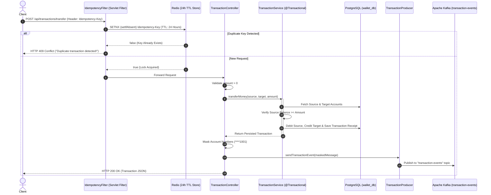

# Digital Wallet Microservice

A containerized, event-driven backend financial ledger built with **Java 17** and **Spring Boot 3.2.4**. This service handles account creation and peer-to-peer fund transfers with **ACID database transactions**, **Redis-backed idempotency protection** against duplicate charges, **PII-masked audit events**, and **asynchronous Apache Kafka streaming**.

---

## System Architecture & Request Flow

When a client initiates a fund transfer, the request passes through a multi-stage safety pipeline before completing:



---

## Tech Stack

| Layer | Technology | Purpose |
| :--- | :--- | :--- |
| **Language & Runtime** | Java 17 (Eclipse Temurin) | Core application language and lightweight JRE container runtime |
| **Framework** | Spring Boot 3.2.4 | REST APIs, Dependency Injection, Spring Data JPA, Validation |
| **Relational Database** | PostgreSQL | ACID-compliant persistent storage for accounts and transactions |
| **In-Memory Store** | Redis | Distributed idempotency key tracking (`SETNX` with 24-hour expiration) |
| **Message Broker** | Apache Kafka | Asynchronous event streaming on `transaction-events` topic |
| **Testing** | JUnit 5, Mockito, AssertJ, H2 | Unit, slice (`@WebMvcTest`, `@DataJpaTest`), and full integration tests |
| **Containerization** | Docker & Docker Compose | Multi-stage Maven/JRE build and full-stack orchestration |

---

## Core Engineering Highlights

### 1. Network-Level Idempotency Protection (`IdempotencyFilter`)

- In financial systems, transient network latency or timeouts can cause client retries, risking duplicate transfers.
- `IdempotencyFilter` intercepts incoming `POST` requests and extracts the `Idempotency-Key` header.
- Uses Redis atomic `setIfAbsent(key, "processed", 24, TimeUnit.HOURS)`.
- Replay attempts are rejected with **HTTP 409 Conflict** (`"Duplicate transaction detected! Request blocked."`) before ever reaching business logic or PostgreSQL.

### 2. ACID Compliance & Monetary Precision (`TransactionService`)

- **Transactional Integrity**: Marked with `@Transactional`, guaranteeing that debiting the source, crediting the target, and writing the transaction audit entry execute as an atomic transaction. Any exception triggers a complete database rollback.
- **Exact Decimal Arithmetic**: Uses `java.math.BigDecimal` across models, repositories, and controllers to eliminate floating-point rounding errors common with `double`/`float`.

### 3. PII Masking & Event-Driven Audit Trail (`TransactionProducer`)

- Account numbers are masked (`****` + last 4 digits) prior to event broadcast so unmasked financial identifiers never leak to external brokers or logs.
- Asynchronously broadcasts to Kafka topic `transaction-events` via `KafkaTemplate`.

### 4. Multi-Stage Docker Build

- **Build Stage** (`maven:3.9.6-eclipse-temurin-17`): Compiles source code and packages the JAR in an isolated environment.
- **Runtime Stage** (`eclipse-temurin:17-jre`): Copies only the packaged JAR into a minimal JRE image, drastically minimizing container footprint and attack surface.

---

## Project Structure

```plaintext
digital-wallet/
├── docker-compose.yml                  # Orchestrates Postgres, Redis, Kafka, and Wallet Service
└── wallet-service/
    ├── Dockerfile                      # Multi-stage Maven build -> JRE 17 runtime
    ├── pom.xml                         # Maven dependencies & Surefire test configuration
    └── src/
        ├── main/java/com/wallet/
        │   ├── config/KafkaConfig.java             # Kafka ProducerFactory & KafkaTemplate beans
        │   ├── controller/AccountController.java   # POST /api/accounts
        │   ├── controller/TransactionController.java # POST /api/transactions/transfer + PII masking
        │   ├── filter/IdempotencyFilter.java       # Redis 24h idempotency check (HTTP 409)
        │   ├── model/Account.java                  # JPA Entity (accounts table)
        │   ├── model/Transaction.java              # JPA Entity (transactions table)
        │   ├── repository/AccountRepository.java   # Spring Data JPA repository
        │   ├── repository/TransactionRepository.java
        │   ├── service/AccountService.java         # Account creation logic
        │   ├── service/TransactionProducer.java    # Kafka event publisher
        │   └── service/TransactionService.java     # Core ACID transfer business logic
        └── test/java/com/wallet/
            ├── TransactionControllerTest.java      # Web layer unit/slice tests (@WebMvcTest)
            ├── TransactionIntegrationTest.java     # End-to-end integration tests (@SpringBootTest)
            ├── TransactionProducerTest.java        # Kafka producer unit tests
            ├── TransactionRepositoryTest.java      # JPA repository slice tests (@DataJpaTest)
            └── TransactionServiceTest.java         # Business logic unit tests (Mockito)
```
